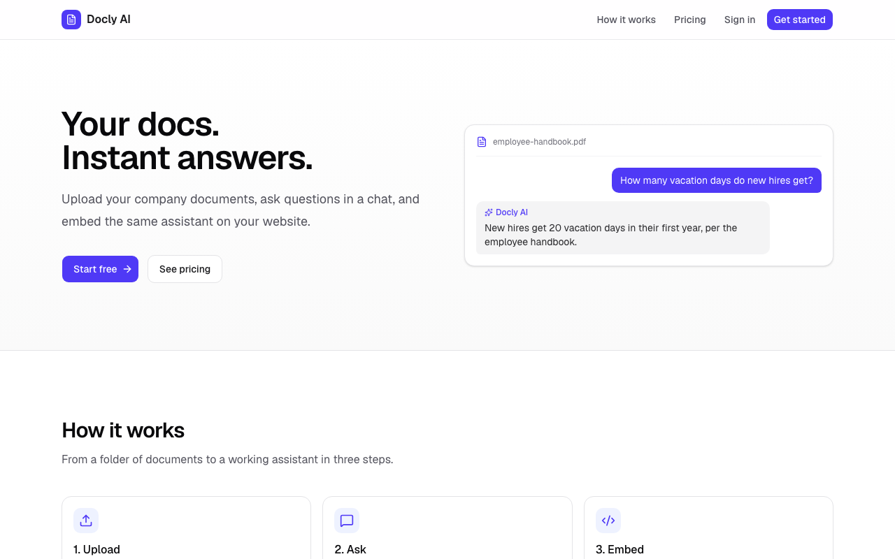
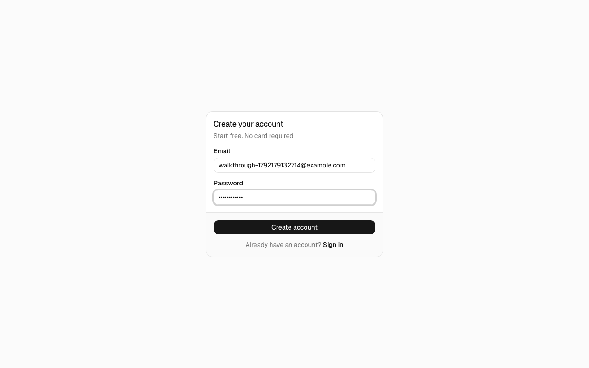
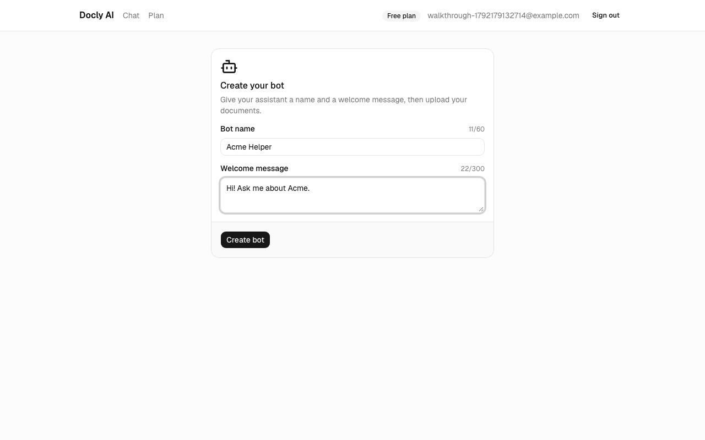
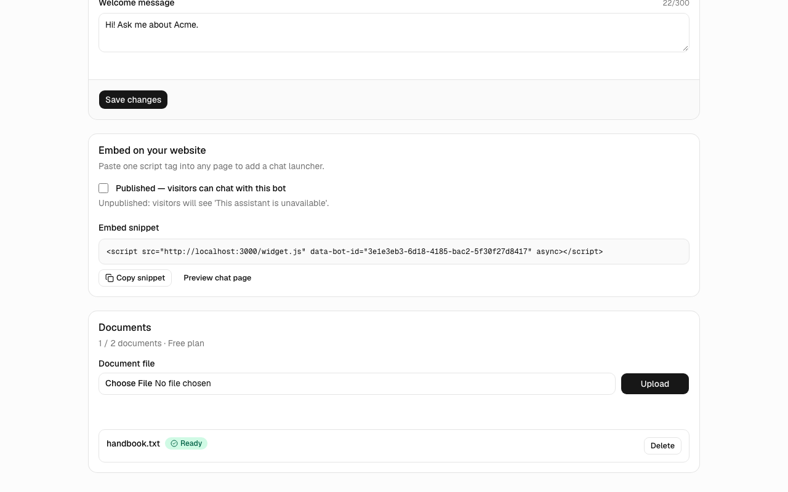
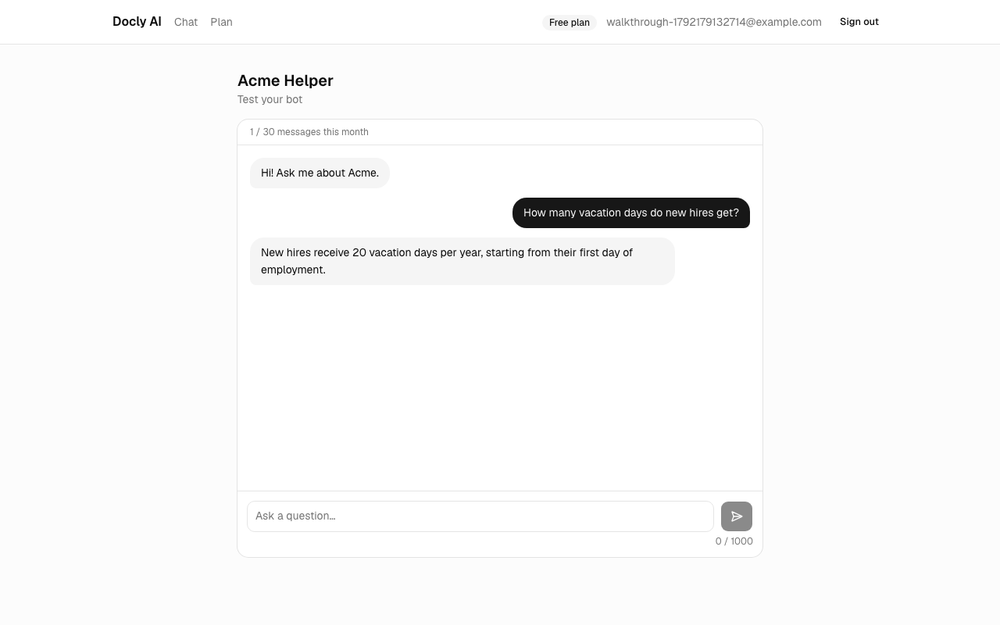
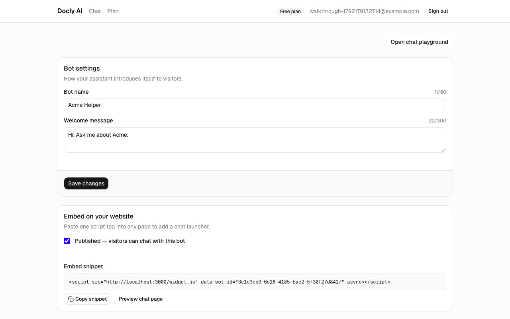
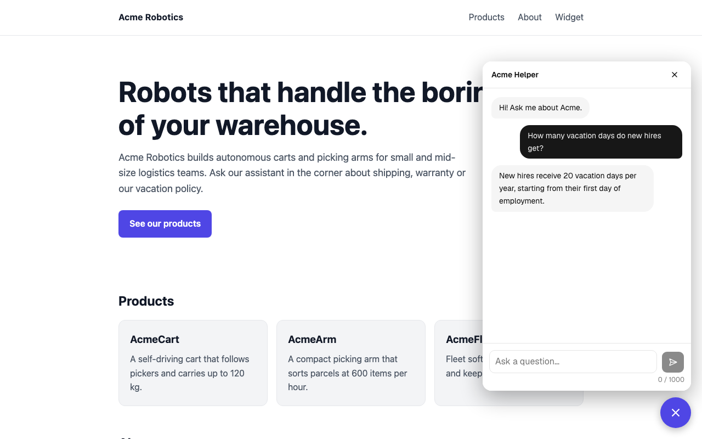
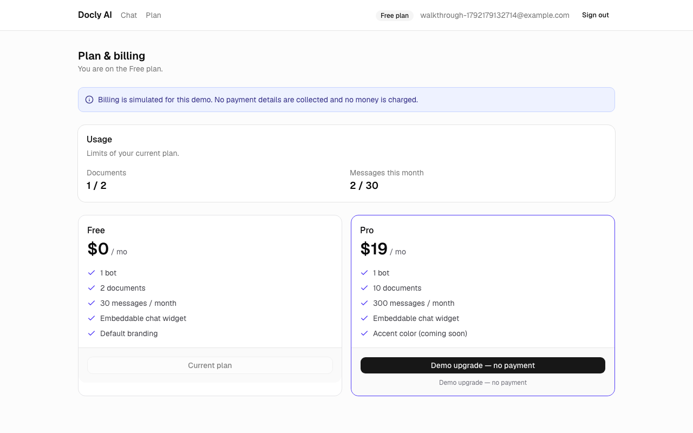
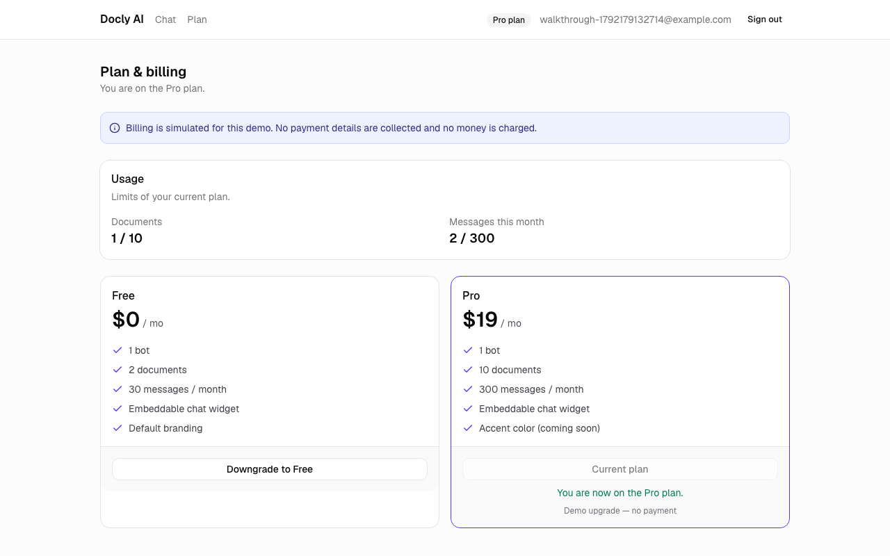

# Illustrated walkthrough

The full demo journey on desktop (1280x800), from the landing page to a widget on a third-party site and a demo plan change. The screenshots are generated by the `WALKTHROUGH=1` Playwright spec against a local dev server with real Gemini answers.

Regenerate them with:

```bash
WALKTHROUGH=1 npx playwright test e2e/walkthrough.spec.ts --project=desktop
```

## 1. Landing



The landing page explains the product and shows the Free and Pro plans. Visitors go to sign-up from here.

## 2. Sign up



An account needs only an email and a password. After sign-up the user lands on the dashboard.

## 3. Create the bot



Each account has one bot with a name and a welcome message, which visitors see first.

## 4. Upload a document



A PDF or TXT file is uploaded, split into chunks and embedded. The status goes from Processing to Ready, and the Free plan counter shows documents used.

## 5. Ask a question in the playground



The owner tests the bot. The answer comes only from the uploaded documents, and the monthly message counter goes up.

## 6. Publish and copy the embed snippet



Switching **Published** on makes the bot available to visitors. The dashboard shows the one-line `<script>` tag to paste into any website.

## 7. The widget on another website



On the demo site, which is a different origin without any owner cookies, a floating launcher opens the chat. It uses the same answer pipeline, and the question counts against the owner's monthly quota.

## 8. Plan and billing



The Plan page shows usage and both plans. Billing is simulated: the upgrade button says "Demo upgrade, no payment" and no card details are collected.

## 9. After the demo upgrade



After confirming, the badge reads Pro and the limits change right away (10 documents, 300 messages per month).
